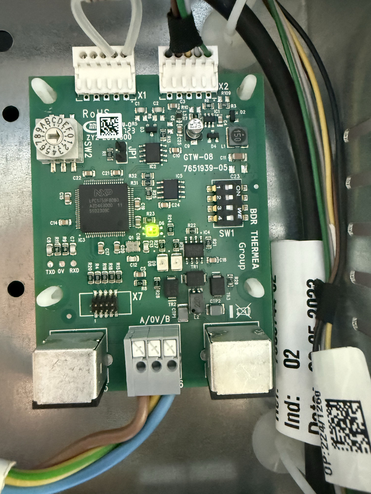
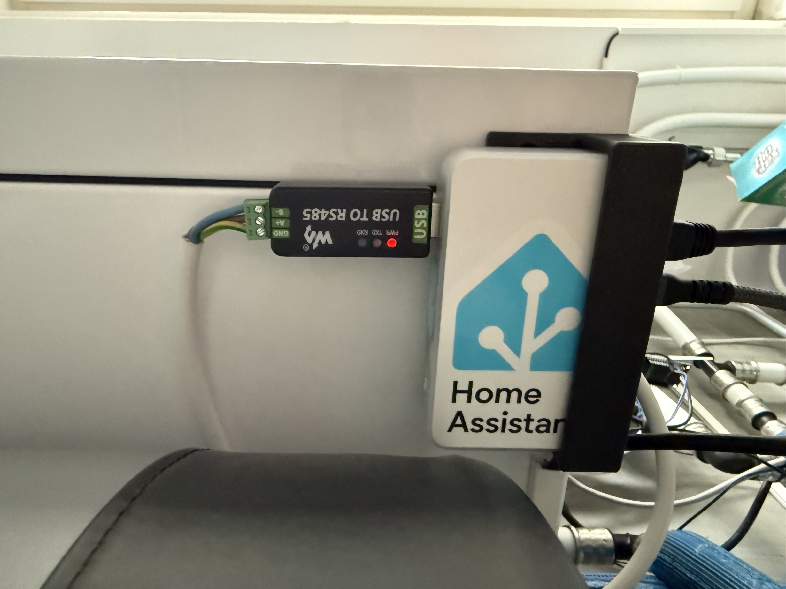
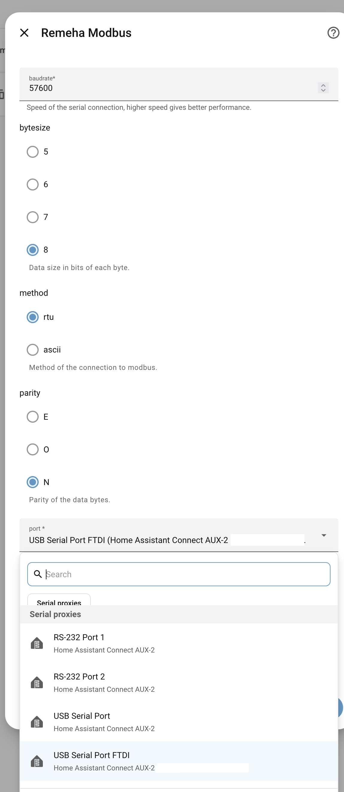
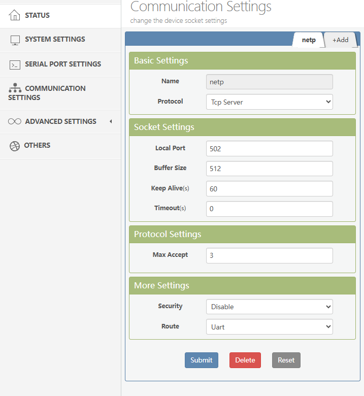
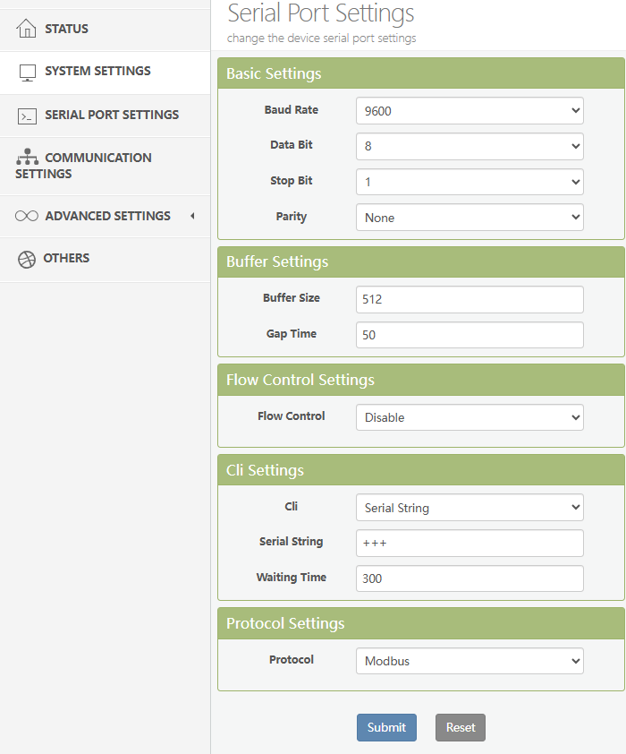
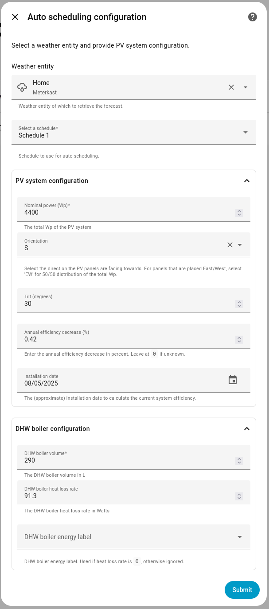
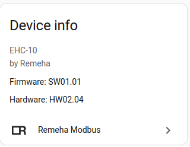
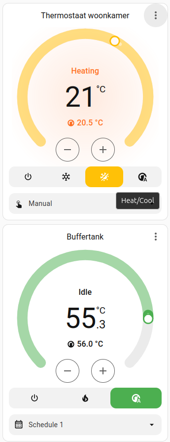
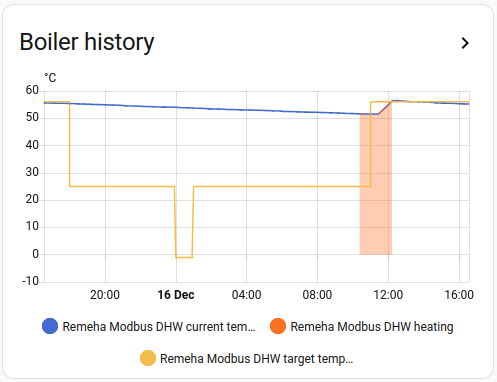
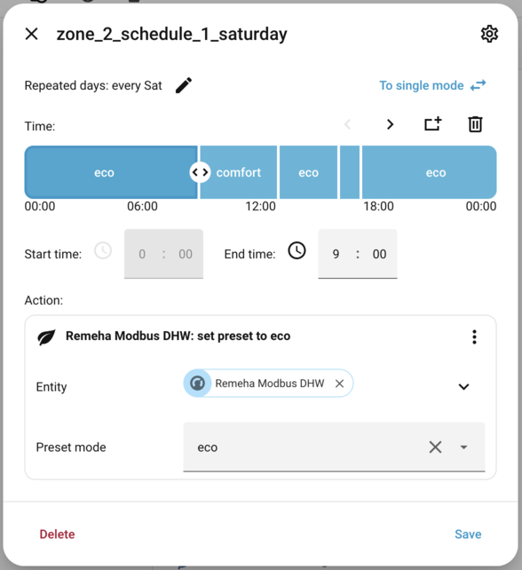

# Remeha Modbus Gateway integration for Home Assistant

<picture>
  <source media="(prefers-color-scheme: dark)" srcset="./custom_components/remeha_modbus/brand/dark_logo.png">
  
</picture>


[](https://github.com/houthacker/remeha-modbus/actions/workflows/hassfest.yaml)
[](https://github.com/houthacker/remeha-modbus/actions/workflows/hacs.yaml)
[](https://github.com/houthacker/remeha-modbus/actions/workflows/pytest.yaml)
[](https://github.com/houthacker/remeha-modbus/actions/workflows/coverage.yaml)
[](https://github.com/houthacker/remeha-modbus/releases/latest)
[](https://buymeacoffee.com/houthacker)

This integration allows you to manage your Remeha heating/cooling appliance locally from Home Assistant.

### Like this integration?

Star remeha-modbus [on github  &#x2B50;](https://github.com/houthacker/remeha-modbus)

## Table of Contents
- [Installation](#installation)
- [Current features](#current-features)
- [Modbus Discovery Table](#modbus-discovery-table)
- [DHW Auto Scheduling](#dhw-auto-scheduling)
- [DHW Schedule Synchronization](#dhw-schedule-synchronization)
- [Noteworthy entities](#entities)
- [Exposed services](#services--actions)
- [Supported appliances](#supported-appliances)
- [Supported modbus proxies](#supported-modbus-proxies)

## Installation

To install this integration, you need to have [HACS](https://hacs.xyz/docs/use) installed in your Home Assistant.

[](https://my.home-assistant.io/redirect/hacs_repository/?owner=houthacker&repository=remeha-modbus&category=integration)

## Current features

Planned features and features under discussion are available in the [issues](https://github.com/houthacker/remeha-modbus/issues). If you're missing a feature that has not been mentioned yet in the issues, please submit an issue or a PR.

- Connections:
  - Directly through a serial port
  - Indirectly through a proxy over WiFi or ethernet.
- Supported climate zones are exposed as the following entity types:
  - DHW (domestic hot water): [water_heater](https://www.home-assistant.io/integrations/water_heater/)
  - CH (central heating): [climate](https://www.home-assistant.io/integrations/climate/)
  - Automatically discovered once the integration has been set up.
  - Linked to a device, showing the type of board in the Remeha appliance, including its soft- and hardware versions.
  - Climate features are enabled depending on the climate zone type (for instance, a DHW zone is only able to heat, not cool).
- DHW auto scheduling:
  - This integration exposes a service called `dhw_auto_schedule` that can be used in automations or scripts. A detailed explanation follows [below](#dhw-auto-scheduling).
- Time schedule editing:
  If you install the [scheduler](https://github.com/nielsfaber/scheduler-card) integration, you can edit your DHW schedules from Home Assistant after [enabling it](#switchenable_schedule_sync). Description is located [here](#dhw-schedule-synchronization).

### Modbus discovery table

At some point when installing the GTW-08 in your appliance, the meta data of your appliance is stored in
the "discovery table". This encompasses registers 128 - 199 and some more in the zone register list. For reasons
yet unknown, this table can become corrupted. Educated guesses (but guesses nonetheless) as to why this happens
might be power cycles, updating the zone configuration or adding new hardware _after_ te GTW-08 has been installed.

To allow users to force the GTW-08 to rediscover your appliance configuration, `remeha_modbus` exposes a service
named `force_system_rediscovery`. This service can be called manually, but is also used in an automatic repair
when a possibly corrupted discovery table is found after Home Assistant has started.
Home Assistant must be restarted after this service has been called.

## Supported appliances

According to Remeha, the following appliances can be extended with a GTW-08 (modbus interface), or have one pre-installed:

| Appliance type       | Supported by GTW-08 | Tested  |                                           Notes |
| -------------------- | :-----------------: | :-----: | ----------------------------------------------: |
| Azorra Ace           |       &check;       | &check; | Heat pump boiler; support is experimental       |
| Confida 40 / 10      |       &check;       | &check; |
| Confida 50E          |       &check;       | &check; |
| Elga Ace             |       &check;       | &check; |
| Elga Ace MB          |       &check;       | &cross; |
| Eria Tower           |       &check;       | &cross; |
| Eria Tower Ace (S)   |       &check;       | &cross; |
| Gas 220 Ace          |       &check;       | &cross; |
| Gas 320/620 Ace      |       &check;       | &cross; |
| Hera Condens HC 3-32 |       &check;       | &check; | [see below](#notes-on-the-hera-condens-hc-3-32) |
| Mercuria             |       &check;       | &cross; |
| Mercuria Ace         |       &check;       | &check; |
| Mercuria Ace MB      |       &check;       | &check; |
| miTerra              |       &check;       | &cross; |
| miTerra plus         |       &check;       | &cross; |
| Quinta Ace 65        |       &check;       | &check; |
| Quinta Ace 160       |       &check;       | &cross; |

This integration is known to be working with the tested devices, but since the modbus interface is the same for all others, it is very likely that it will work for those too. This list is also available on the Remeha site (Dutch &#x1f1f3;&#x1f1f1;): [Remeha modbus support](https://kennisbank.remeha.nl/welke-remeha-toestellen-hebben-een-modbus-interface/).

### Notes on the Hera Condens HC 3-32

- If the mainboard is a `CU-OH-04`, the GTW-08 is supported on the L-Bus connector X13.
- The heating returns water temperature reads `-33` as long as the physical NTC sensor has not been added.
- Water pressure value of the appliance (register 409, `varApWaterPressure`) appears to be incorrect.

## Supported modbus proxies

The following proxies are known to be working with this integration. Other gateways or proxies probably work as well, but haven't been tested.

| Device type                                               | URL                                                                     | Notes |
| --------------------------------------------------------- | ----------------------------------------------------------------------- | - |
| Home Assistant Connect AUX-2 & Waveshare USB to RS485 (B) | https://www.home-assistant.io/connect/aux-2/                            | - |
| ESPHome Modbus TCP to RTU Bridge                          | https://github.com/rosenrot00/esphome_modbus_bridge                     | Connect to the Remeha appliance without a dedicated USB/RS485 adapter or gateway. |
| Waveshare RS232/485 to WiFi and Ethernet                  | https://www.waveshare.com/product/rs232-485-to-wifi-eth-b.htm?sku=25222 | When setting a static ip, the device is only reachable in the same subnet since no default gateway can be set. |
| PUSR USR-DR132 / USR-DR134                                | https://www.pusr.com/products/Lipstick-Size-Serial-Device-Server.html   | Seems most reliable in **Modbus Multi Host Polling** mode, probably avoids frame misalignment on L-bus |
| Elfin EW1X                                                | http://www.hi-flying.com/elfin-ew10-elfin-ew11                          | - |

### General
The following proxy configurations are known to work with the GTW-08. If you're using different settings that also work, please let me know by creating [a new issue](https://github.com/houthacker/remeha-modbus/issues/new/choose).

### Home Assistant Connect AUX-2

#### Connecting the AUX-2 to your appliance
Refer to the images below to see how the AUX-2 should be connected to your appliance. In general, you can connect the ground, A and B lines to their counterparts on the Waveshare dongle.
For some older GTW-08 versions, the A and B must be switched.

Connecting to the GTW-08
<details>



</details>

Connecting to the Waveshare dongle
<details>



</details>

#### Configuring the AUX-2
You can use the AUX-2 as a serial proxy. To set it up, use the instructions over at [Nabu Casa](https://support.nabucasa.com/hc/en-us/articles/40527754954653-Set-up-Home-Assistant-Connect-AUX-2#set-up-the-device).

After setting it up, follow instructions [here](https://support.nabucasa.com/hc/en-us/articles/40528804425245-Using-Connect-AUX-2-with-Modbus-devices) to use the Waveshare USB to RS485 (B) to connect the GTW-08
to the AUX-2.
This dongle is supported by Home Assistant but you can of course use different ones. Just make sure you set the correct `vid` and `pid` in the `usb_uart` section of the yaml, and adjust `aux-2.yaml` to your needs.

#### Configuring remeha-modbus
When the proxy is set up successfully, (re)configure this integration to use it. To do that, select the `serial` connection method and choose the AUX-2 sourced serial port.

<summary>Screenshot of remeha-modbus configuration</summary>
<details>



</details>

An example ESPHome yaml configuration using the Waveshare dongle is listed below.
<details>

```yaml
substitutions:
  name: connect-aux-2
  friendly_name: Home Assistant Connect AUX-2

packages:
  Nabu Casa.Home Assistant Connect AUX-2: "github://NabuCasa/aux-2/packages/aux-2.yaml@main"

esphome:
  name: ${name}
  name_add_mac_suffix: false
  friendly_name: ${friendly_name}

wifi:
  ssid: !secret wifi_ssid
  password: !secret wifi_password

api:
  encryption:
    key: !secret connect_aux_2_encryption_key

usb_uart:
  - type: FT232
    vid: 0x0403
    pid: 0x6001
    channels:
      - id: uch_ftdi_serial
        baud_rate: 57600
        buffer_size: 1024

serial_proxy:
  - id: usb_serial_proxy_ftdi
    uart_id: uch_ftdi_serial
    name: USB Serial Port FTDI
    port_type: RS485
```

</details>

### ESPHome Modbus TCP to RTU Bridge
The ESP32 reads and writes the RS485 bus and exposes it as a Modbus TCP server on the configured port (502 in the example yaml).
The integration connects to the ESPHome device over the network, as it would to any Modbus TCP gateway.

#### Notes:
* In the integration, use the IP address (or hostname) of the ESPHome device as the host and use the configured port number. The slave address is the one of your Remeha appliance, for example 100.
* The pins (TX 19, RX 22, flow control 5) are for the Atom Lite with the RS485 Base. Other hardware needs different pins.
* Do not add a modbus_controller to this ESPHome config. It would poll the bus itself and compete with the integration. Trusted_networks should match your own network.

<summary>Minimal ESPHome config</summary>
<details>

```yaml
esphome:
  name: modbus-proxy
  friendly_name: Modbus Proxy

esp32:
  board: esp32dev
  framework:
    type: esp-idf

logger:

api:
  encryption:
    key: !secret api_key

ota:
  - platform: esphome

wifi:
  ssid: !secret wifi_ssid
  password: !secret wifi_password

uart:
  id: uart_modbus
  tx_pin: 19
  rx_pin: 22
  baud_rate: 9600
  stop_bits: 1

external_components:
  - source:
      type: git
      url: https://github.com/rosenrot00/esphome_modbus_bridge
    components: [modbus_bridge]

modbus:
  id: modbus1
  uart_id: uart_modbus
  role: client
  flow_control_pin: 5
  send_wait_time: 500ms
  turnaround_time: 50ms

modbus_bridge:
  id: mb_bridge
  modbus_id: modbus1
  tcp_port: 502
  tcp_allowed_clients: 2
  trusted_networks:
    - 192.168.1.0/24   # adjust to your LAN
```

</details>

### Elfin EW1X
<summary>Configuration details of the Elfin EW1X</summary>
<details>

#### Configuration settings


#### Serial port settings


</details>

## Entities

The entities described here require some extra attention.

| &lt;`domain`&gt;.&lt;`unique_id`&gt;| Description |
|-|-|
| `climate.*` | `climate` entities are added only if their zone function (CP020, modbus base register 641) is not `0: Disabled`. If a zone is enabled in your Remeha appliance after installing this integration, Home Assistant must be restarted or this integration disabled and then enabled to see those changes. |
| `water_heater.*` | Idem |
| `number.compressor_min_temperature` | This entity depicts the minimum _outside_ temperature at which the heat pump compressor will work. Below that temperature the compressor will stop and a backup power generator will take over (like mains power). |
| `select.blocking_input_*_configuration` | Configure the function of blocking inputs on your appliance. The following options are available:<ul><li>`not_used`: Not used.</li><li>`full_blocking`: Completely shuts down the heat pump and any backup heat generators. Frost protection might get disabled too.</li><li>`partial_blocking`: Blocks CH and DHW while maintaining frost protection.</li><li>`user_reset_locking`: Reset active blocking errors on the appliance.</li><li>`backup_relieved`: Allow the backup heater to operate when the contact is active. Block it otherwise.</li><li>`generator_relieved`: Allow the heat pump generator to operate when the contact is active. Block it otherwise.</li><li>`generator_and_backup_relieved`: Combination of both previous options.</li><li>`high_low_tariff`: Optimizes energy costs using parameters `HP062` and `HP063` during peak and off-peak hours.</li><li>`pv_only`: Store surplus PV power using the heat pump only. Uses parameters `HP091` and `HP092` for offsets.</li><li>`pv_and_backup`: Same as `pv_only`, but also allows the backup heater to operate.</li><li>`smart_grid_ready`: Combines `BL1` and `BL2` to interpret 4-state SG Ready utility signals (block, normal, boosted, forced).</li><li>`heat_cool`: Switch the heat pump to heating mode when the contact is active. Switch it to cool otherwise.</li><li>`ch_blocking`: Blocks CH while allowing DHW (only available on newer models).</li></ul>|
| `select.blocking_input_*_logic` | Define when a blocking input is active: <ul><li>`open`: The configured function triggers when the electrical circuit between the contact terminals is broken (normally closed / NC logic).</li><li>`closed`: The configured function triggers when the electrical circuit between the BL1 terminals is bridged/closed (normally open / NO logic).</li></ul> |
| `switch.heatpump_managed_schedules` | This entity is switched on by default, and is unavailable if the `scheduler-component` integration is not installed. If it's available though, switching this switch to 'off' causes the `scheduler-component` to execute the actions listed in synchronized zone schedules directly, instead of letting the Remeha appliance handle schedule execution. This might be undesirable, because:<br><br><ul><li>It might lead to conflicts: if your climate zone is still in scheduling mode, both the Remeha appliance _and_ the `scheduler-component` will attempt to control the heat pump state. To prevent that, the affected climate zone is put in eco mode once this entity is switched off.</li><li>It prevents the heat pump from heating/cooling efficiently because it doesn't know what preset changes are coming up. This might lead to higher energy usage. To ensure that you have been warned about this, an additional persistent notification is triggered.</li></ul> |
| `switch.enable_schedule_sync` | Switched off by default, and is unavailable if the `scheduler-component` integration is not installed. If it's available though, switching this switch to 'on' causes the DHW time zone schedules from your Remeha appliance to be synchronized with the `scheduler-component` integration, allowing you to edit them in Home Assistant as well. |

## Services / actions

### bootstrap_blenders

- Fields: no
- Return value: no
- Raised errors: `RemehaIncorrectServiceCall` if called when any required integrations are missing but
  the related `switch` entities have been enabled by the user.

Bootstraps integrations with other components.
This service is called automatically once Home Assistant has started.
Calling it multiple times has no additional effect, except possibly when the blenders didn't bootstrap somehow.

### dhw_auto_schedule

- Fields: no
- Return value: no
- Raised errors: `RemehaIncorrectServiceCall` if called when either:
  - There is no DHW `climate` or `water_heater` entity.
  - The configured weather forecast does not supply a `solar_irradiance` field

A description of this service is available in [DHW auto scheduling](#dhw-auto-scheduling)

### force_system_rediscovery

To force your appliance to reset the discovery table, execute this service. This integration
must be reloaded after executing this service.

> [!CAUTION]
> Run this service at your own risk. Executing it may mess up your pre-existing Remeha devices and entities
> if devices are added or (re)moved because of the rediscovery.

> Forcing rediscovery does not change your physical appliance settings.

### read_registers

Read arbitrary modbus registers from the Remeha modbus interface.
| Field | Type | Required | Description |
|-------|------|:---------:|-------------|
| `start_register` | `int` | &check; | The address of the first register to read. |
| `register_count` | `int` | &check; | The amount of registers to read (max 10). Defaults to 1 |
| `struct_format` | `str` | &check; | The struct format of the returned registers. Defaults to `=H` |

## DHW auto scheduling

DHW auto scheduling is a feature allowing efficient heating of your DHW boiler by using as much solar power as possible while keeping the
interference to a minimum with other devices also using (direct) solar power.

### How to use

To start using the auto scheduling feature, execute the following steps:

#### Install KNMI weather integration

- Request an API key at [weerlive.nl](https://weerlive.nl/api/toegang/index.php)
- Install the KNMI weather integration using the button below and enter the obtained API key during installation.

[](https://my.home-assistant.io/redirect/hacs_repository/?owner=golles&repository=ha-knmi&category=integration)

#### Reconfigure this integration

- Reconfigure this integration and provide the required information about your PV system and DHW boiler. Select the KNMI weather
  entity to retrieve the weather forecast.

#### Example configuration:



#### Create an automation

- Then just create a new automation with the following properties:
  - Trigger at any time between 22:00 and 23:59
  - Call the Remeha Modbus service `dhw_auto_schedule`
  - Optionally set the DHW boiler climate to preset `schedule_1`.

#### Set the correct DHW preset mode

After creating the automation, a new schedule for the next day will automatically be created. If the preset is not set in the
automation, manually change the preset mode of your DHW boiler climate to `Schedule 1`, otherwise the schedule will of course be inactive.

### Screenshots

#### Remeha Appliance Info



#### Central Heating and Domestic Hot Water (DHW) climates



#### DHW History View

Showing current temperature, target temperature and heating status.



## DHW schedule synchronization

If you enable the `switch.enable_schedule_sync` switch, the DHW time schedules are synchronized between your Remeha appliance
and the [scheduler](https://github.com/nielsfaber/scheduler-card) integration.

> [!NOTE]
> If you edit a time schedule entry in Home Assistant, it takes between 10 and 30 minutes for it to show up in
> the Remeha Home app.
> This is because the Remeha Home app doesn't update the schedules that frequently from external sources like modbus.
> Schedule edits from the Remeha Home app show up within one minute in Home Assistant however.

See also the [heatpump managed schedules](#switchheatpump_managed_schedules) entity.


